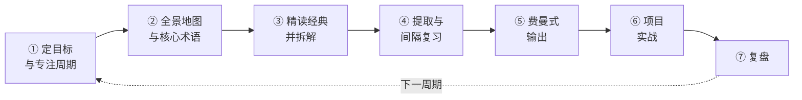

<p align="center">
  
</p>

<h1 align="center">学习方法论手册 · Learning Method Playbook</h1>

<p align="center">
  <strong>把流行的学习法拆开，按证据重新装好。</strong><br>
  Popular study methods, taken apart and rebuilt by evidence.
</p>

<p align="center">
  面向临床医生、科研人员和自学者：27 种学习方法按 A/B/C 三级证据整理，配七步流程、六个模板、一门类比迁移演讲课程和一个细胞周期实例。<br>
  For clinicians, researchers and self-learners: 27 methods graded by evidence, a seven-step workflow, six templates, a lecture course on analogical transfer and a worked cell-cycle example.
</p>

<p align="center">
  <a href="README.md">简体中文</a> · <a href="文档/英文说明v1.0.md">English</a>
</p>

<p align="center">
  <a href="https://github.com/TUANZIDING/learning-method-playbook/actions"></a>
  <a href="LICENSE"></a>
  <a href="文档/证据分级v1.0.md"></a>
  <a href="文档/参考文献v1.0.md"></a>
</p>

<p align="center">
  <code>三级证据分层</code> · <code>流行说法核查</code> · <code>七步学习流程</code> · <code>六个模板</code> · <code>演讲课程</code> · <code>引用联网核对</code>
</p>

<p align="center">
  <a href="#use-cases">使用场景</a> ｜ <a href="#methods">方法一览</a> ｜ <a href="#workflow">学习流程</a> ｜ <a href="#quick-start">快速开始</a> ｜ <a href="#capabilities">能力状态</a> ｜ <a href="#contribute">参与共创</a>
</p>

<p align="center"><sub>主图为本仓库原创SVG概念图。本仓库只收录作者自己的概括、书目信息与链接，不包含书籍或论文原文、原图。当前版本 1.2.0（2026-10-27）。</sub></p>

---

<a id="use-cases"></a>

## 从你的问题进入 · Use cases

网上流传的“西蒙学习法 + 布鲁姆认知模型 + 费曼学习法 + PBL”四步法有用，但混着几条不实说法。这里保留它们的合理内核，补上证据最强却常被漏掉的两件事：**提取练习**和**间隔复习**。

| 你想做什么 | 可以怎样开始 |
| --- | --- |
| 两周内入门一个陌生领域 | [七步学习流程](文档/学习流程v1.0.md) → [学习计划模板](模板/学习计划v1.0.md) |
| 知道哪些学习法真的有研究支持 | [方法总表](文档/方法总表v1.0.md) · [A 级方法](文档/A级方法v1.0.md) |
| 核实“60 个知识点半年成专家”“学习金字塔”等说法 | [流行说法核查](文档/流行说法核查v1.0.md) |
| 高效读论文、拆解经典文献 | [三遍阅读法](文档/B级方法v1.0.md#b7) · [文献拆解模板](模板/文献拆解v1.0.md) |
| 检验自己是否真的懂了 | [费曼自测](模板/费曼自测v1.0.md) · [SOLO 自评](文档/B级方法v1.0.md#b2) |
| 选闪卡、笔记、画图工具 | [开源工具与资源](文档/开源资源v1.0.md)（Anki/FSRS、Zotero、Obsidian 等，含星数与许可证） |
| 用自己最熟的领域学新领域 | [类比迁移 B9](文档/B级方法v1.0.md#b9) · [60 分钟演讲课程](课程/类比迁移课程v1.0.md) · [类比映射表](模板/类比映射表v1.0.md) |
| 看一个完整例子 | [从零学细胞周期](示例/细胞周期应用v1.0.md) |

<a id="methods"></a>

## 方法一览 · Methods at a glance

| 等级 | 含义 | 方法 |
| --- | --- | --- |
| **A 实证强** | 多项随机实验 + 元分析 | 提取练习、间隔重复、交错练习、精细询问、自我解释、双重编码、具体例子、刻意练习、认知负荷/样例效应、元认知校准、睡眠与记忆巩固；成长型思维（研究多但效应小、有争议） |
| **B 理论公认** | 经典框架，整套方法缺强对照 | 布鲁姆分类、SOLO、费曼式解释、PBL、组块与专家理论、概念图、三遍阅读法、卡片笔记、类比迁移（借熟悉学陌生） |
| **C 实践推崇** | 书籍与经验，缺乏对照研究 | 多元思维模型、第一性原理、《原则》、超级学习者、学习如何学习、复盘/AAR（例外：汇报有元分析） |

每条方法都写明：一句话定义、原始出处、证据等级与关键研究、常见误传、操作步骤、在医学/科研学习中的用法。[完整总表 →](文档/方法总表v1.0.md)

<a id="workflow"></a>

## 七步学习流程 · Workflow



| 步骤 | 主要方法 | 模板 |
| --- | --- | --- |
| ① 定目标与专注周期 | 布鲁姆六层目标、元学习 | [学习计划](模板/学习计划v1.0.md) |
| ② 全景地图与核心术语 | 认知负荷、组块、概念图 | — |
| ③ 精读经典并拆解 | 三遍阅读、精细询问、自我解释、具体例子 | [文献拆解](模板/文献拆解v1.0.md) |
| ④ 提取与间隔复习 | 提取练习、间隔重复、交错练习 | [间隔复习表](模板/间隔复习表v1.0.md) |
| ⑤ 费曼式输出 | 教中学、SOLO、双重编码 | [费曼自测](模板/费曼自测v1.0.md) |
| ⑥ 项目实战 | PBL、刻意练习、第一性原理 | — |
| ⑦ 复盘 | AAR 四问、判断校准 | [复盘表](模板/复盘表v1.0.md) |

[每一步做什么、为什么、做到什么程度 →](文档/学习流程v1.0.md)

<a id="quick-start"></a>

## 先用起来 · Quick start

**只想读：** 从 [方法总表](文档/方法总表v1.0.md) 或 [七步流程](文档/学习流程v1.0.md) 开始，全部是 Markdown，GitHub 上直接渲染 Mermaid 图。

**想用模板：** 复制 `模板/` 里的文件到自己的笔记库，按主题改名（如 `学习计划-细胞周期v1.0.md`）。

**想核对引用：** 只依赖 Python 3 标准库。

```sh
git clone https://github.com/TUANZIDING/learning-method-playbook.git
cd learning-method-playbook
python3 验证/项目检查v1.0.py            # 本地链接、锚点、命名、SVG
python3 验证/引用核对v1.0.py            # 正文引用与文献表一致
python3 验证/引用核对v1.0.py --online   # 逐条走 Crossref / PubMed / Open Library
```

<a id="capabilities"></a>

## 当前包含什么 · Capability status

| 状态 | 内容 | 实际边界 |
| --- | --- | --- |
| 已整理 | 27 种方法（A 12 · B 9 · C 6）、流行说法核查 | 是入门级证据概括，不是系统综述 |
| 已整理 | 122 条参考文献（99 篇论文或章节、13 本图书、10 个网页）；其中 121 条提供可联网核对的标识 | 1956 年 Bloom 原版无 ISBN，以后续综述为入口；书目核对不等于证据质量评价 |
| 已整理 | 33 个相关开源仓库，标注星数、许可证与对应方法 | 星数为 2026-10-27 读数；受欢迎不等于有证据 |
| 可用 | 六个 Markdown 模板 + 一个 CSV 复习表；一门 60 分钟演讲课程 | 不含自动排期程序；可接 Anki/FSRS |
| 示例 | 细胞周期七步实例 | 生物学内容为入门概括，以教材和原文为准 |
| 不包含 | 书籍或论文原文、原图；医学或教育决策建议 | 需要原文请通过参考文献中的 DOI 获取 |

> **使用提醒：** “证据强”说明效应可重复，不保证对每个人、每种材料同样有效；C 级方法缺乏对照研究，请当作思路而不是结论。

<a id="contribute"></a>

## 一起把它做得更清楚 · Contribute

欢迎补充新方法、更好的医学教育证据、失效链接报告。新增方法请按 [扩充指南](文档/扩充指南v1.0.md) 的格式写，并在提交前运行两项检查。

| 你想了解什么 | 从这里进入 |
| --- | --- |
| 证据分级规则 | [证据分级](文档/证据分级v1.0.md) |
| 全部文献 | [参考文献](文档/参考文献v1.0.md) · [机器可读 JSON](验证/参考文献v1.0.json) |
| 开源工具与资源 | [开源资源](文档/开源资源v1.0.md) |
| 用 Codex 按同样风格扩充 | [扩充指南](文档/扩充指南v1.0.md) |
| 来源、版权与许可 | [素材说明](文档/素材说明v1.0.md) |
| English overview | [English homepage](文档/英文说明v1.0.md) |
| 细胞周期学习笔记 | [TUANZIDING/cell-cycle-from-zero](https://github.com/TUANZIDING/cell-cycle-from-zero) |
| 本仓库的问题或建议 | [GitHub Issues](https://github.com/TUANZIDING/learning-method-playbook/issues) |

---

<p align="center">
  <strong>学习方法论手册 · Learning Method Playbook</strong><br>
  先回忆，再学新；讲出来，做出来。<br>
  <a href="https://github.com/TUANZIDING">TUANZIDING</a> · <a href="LICENSE">MIT</a> · <a href="文档/素材说明v1.0.md">素材来源</a>
</p>

<sub>本仓库的原创文档、SVG 与脚本采用 MIT 许可。所引书籍、论文、演讲与开源项目的版权归各自作者和权利人所有，本仓库只提供书目信息、链接与作者自己的概括。</sub>
