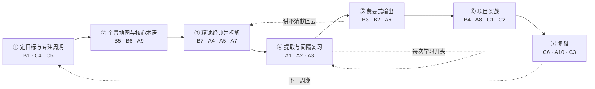
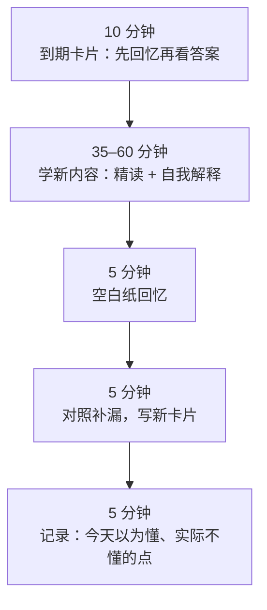

# 七步学习流程 · The seven-step workflow

把 A、B、C 三级方法串成一个可执行的循环。一个“学习周期”建议 4–8 周，以一份可交付成果结束。每一步标出用到的方法编号；A 级方法是骨架，B、C 级是框架和纪律。

**一句话结论：** 先用一周搭框架，然后每次学习都“先回忆、后学新、讲出来、做出来”，周期结束复盘。

## ① 定目标与专注周期

- **做什么：** 写下这个周期结束时要交付的东西（讲一次课、写一篇综述、复现一张图），按布鲁姆六层写 6 条目标；划定每周固定的专注时段。
- **为什么：** 目标决定“要记多久”，从而决定间隔（[A2](A级方法v1.0.md#a2)）；先花约 10% 时间做“元学习”调研这门学问怎么学（[C4](C级方法v1.0.md#c4)）。
- **模板：** [学习计划](../模板/学习计划v1.0.md)
- **完成标准：** 有截止日期、有交付物、有 6 条可检验的目标。

## ② 建全景地图与核心术语

- **做什么：** 读 1 本教材章节或 1–2 篇综述（不是最新原始论文），画 10–20 个节点的概念图，列 30–60 个核心术语。
- **为什么：** 新手先要样例和框架降低无关负荷（[A9](A级方法v1.0.md#a9)）；核心术语是第一批“组块”（[B5](B级方法v1.0.md#b5)）；概念图是全景地图（[B6](B级方法v1.0.md#b6)）。
- **注意：** 30–60 个术语是**入门**清单，不是“掌握 60 个知识点就成专家”（见 [流行说法核查](流行说法核查v1.0.md)）。
- **完成标准：** 合上资料能重画骨架图。

## ③ 精读经典并拆解

- **做什么：** 选 3–5 篇奠基性原始论文，用三遍阅读法；第三遍时对每个关键结论问“为什么”、对每个图做自我解释、找两个例子和一个反例。
- **为什么：** [B7](B级方法v1.0.md#b7) 控制阅读成本；[A4](A级方法v1.0.md#a4)、[A5](A级方法v1.0.md#a5)、[A7](A级方法v1.0.md#a7) 把阅读变成加工。
- **模板：** [文献拆解](../模板/文献拆解v1.0.md)
- **完成标准：** 不看原文能说出“问题—方法—关键证据—局限”。

## ④ 提取与间隔复习

- **做什么：** 每次学习的前 10 分钟先做到期卡片；新内容学完立刻做空白纸回忆；易混概念放在一起交错练。
- **为什么：** 本流程中证据最强的一步（[A1](A级方法v1.0.md#a1)、[A2](A级方法v1.0.md#a2)、[A3](A级方法v1.0.md#a3)）。
- **模板：** [间隔复习表](../模板/间隔复习表v1.0.md)；工具见 [开源资源](开源资源v1.0.md#srs)。
- **完成标准：** 到期卡片当天清零；答错的卡自动缩短间隔。

## ⑤ 费曼式输出

- **做什么：** 每周选 1–2 个核心概念，不看资料讲 3 分钟并录音；用 SOLO 判断讲到哪一层；画一张图配合讲解；最后请懂行的人或对照原文挑错。
- **为什么：** “教中学”有元分析支持（[B3](B级方法v1.0.md#b3)）；SOLO 给出可操作的自评尺（[B2](B级方法v1.0.md#b2)）；图文互译（[A6](A级方法v1.0.md#a6)）。
- **模板：** [费曼自测](../模板/费曼自测v1.0.md)
- **完成标准：** 达到“关联结构”，且外部核对无事实错误。

## ⑥ 项目实战

- **做什么：** 用一个真实问题驱动应用：一个病例、一个自己的数据问题、一次复现分析；把卡住的子技能拆出来刻意练习。
- **为什么：** PBL 的价值在应用和迁移（[B4](B级方法v1.0.md#b4)），但要在第 2–3 步之后才开始，避免新手“无指导摸索”；[A8](A级方法v1.0.md#a8) 针对弱点；[C1](C级方法v1.0.md#c1)、[C2](C级方法v1.0.md#c2) 帮助提出假设。
- **完成标准：** 交付物完成（对应第 1 步写下的那一项）。

## ⑦ 复盘

- **做什么：** 周期结束时回答：期望什么、实际怎样、差异原因、下次怎么做；对照第 1 步的 6 条目标逐条打分；把教训写成一条“原则”。
- **为什么：** 复盘/汇报有元分析支持（[C6](C级方法v1.0.md#c6)）；用测验结果而不是感觉评估（[A10](A级方法v1.0.md#a10)）；原则库（[C3](C级方法v1.0.md#c3)）。
- **模板：** [复盘表](../模板/复盘表v1.0.md)

## 每次学习的固定结构（60–90 分钟）

## 时间分配参考（不是固定比例）

| 阶段 | 第 1 周 | 第 2–3 周 | 第 4 周起 |
| --- | --- | --- | --- |
| 读与听（输入） | 多 | 中 | 少 |
| 提取与复习 | 少量开始 | 每次必做 | 每次必做 |
| 输出与实战 | 少 | 中 | 多 |

不使用“20% 看书、80% 实战”之类的固定比例，因为它没有可靠出处；比例应随熟练度变化，这也与专长反转效应一致（[A9](A级方法v1.0.md#a9)）。

应用示例：[用这套流程从零学细胞周期](../示例/细胞周期应用v1.0.md)

[← 返回首页](../README.md)
