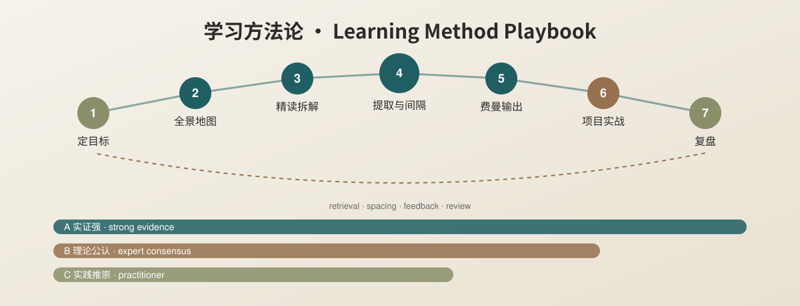

<p align="center">
  
</p>

<h1 align="center">Learning Method Playbook · 学习方法论手册</h1>

<p align="center">
  <strong>Popular study methods, taken apart and rebuilt by evidence.</strong><br>
  把流行的学习法拆开，按证据重新装好。
</p>

<p align="center">
  <a href="../README.md">简体中文</a> · <a href="英文说明v1.0.md">English</a>
</p>

<p align="center">
  <a href="https://github.com/TUANZIDING/learning-method-playbook/actions"></a>
  <a href="../LICENSE"></a>
</p>

---

<a id="overview"></a>

## What this is

A Chinese-first playbook for learning any new field quickly, written for clinicians and researchers. It starts from a viral Chinese "four-step method" (Simon + Bloom + Feynman + PBL), keeps what is sound, and corrects what is not:

- **"Master 60 knowledge points in six months" is not Herbert Simon's claim.** Simon & Chase (1973) estimated roughly 50,000 stored chess patterns and about a decade of intense practice for grandmasters.
- **Bloom's taxonomy is a hierarchy of cognitive objectives** (revised by Anderson & Krathwohl, 2001), not a knowledge-mapping technique.
- **"Read 20%, practise 80%"** has no reliable source; it belongs with the debunked learning pyramid (Masters, 2013).
- **"The Feynman Technique"** is a later label for Feynman's teaching style; learning-by-teaching itself has meta-analytic support (Kobayashi, 2019).

## Evidence tiers

| Tier | Meaning | Methods |
| --- | --- | --- |
| A | Replicated experiments plus meta-analyses | Retrieval practice, spacing, interleaving, elaborative interrogation, self-explanation, dual coding, concrete examples, deliberate practice, cognitive load / worked examples, metacognitive calibration, sleep and memory consolidation (effects depend on the task); growth-mindset interventions (many studies, small and contested effects) |
| B | Established frameworks without strong controlled tests of the whole method | Bloom (revised), SOLO, Feynman-style explanation, PBL, chunking and expertise, concept mapping, Keshav's three-pass reading, Zettelkasten, analogical transfer (learning the unfamiliar through a familiar domain) |
| C | Practitioner advice, no controlled studies | Munger's mental models, first principles, Dalio's Principles, Ultralearning, Learning How to Learn; after-action review (exception: debriefing has a meta-analysis) |

## Seven-step workflow

Set goals and focus blocks → build a map and core vocabulary → read classic papers closely → retrieve and space → explain Feynman-style → apply in a project → review. Templates for each step are in `模板/` (plan, paper breakdown, Feynman self-test, spaced-review log, after-action review). A worked example applies the workflow to the cell cycle.

<a id="quick-start"></a>

## Quick start

```sh
git clone https://github.com/TUANZIDING/learning-method-playbook.git
cd learning-method-playbook
python3 验证/项目检查v1.0.py
python3 验证/引用核对v1.0.py --online
```

The citation checker resolves DOI on Crossref, PMIDs on PubMed, ISBNs on Open Library and web links by HTTP status (Python 3 standard library only). The list contains 122 references; one book without an ISBN uses a later overview as an entry point.

## Copyright

Only the author's own summaries, bibliographic data and links are included; no book or paper text or figures. Original documents, SVG and scripts are MIT-licensed.

<p align="center"><a href="https://github.com/TUANZIDING">TUANZIDING</a> · <a href="../LICENSE">MIT</a></p>
