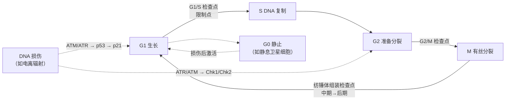

# 应用示例：从零学细胞周期 · Worked example: the cell cycle

演示如何用 [七步学习流程](../文档/学习流程v1.0.md) 学一个新领域。学习者设定：临床医生，研究方向为放射性骨骼肌损伤，需要理解 DNA 损伤应答、检查点与肌卫星细胞增殖。学习笔记与图解在姊妹仓库 [TUANZIDING/cell-cycle-from-zero](https://github.com/TUANZIDING/cell-cycle-from-zero)。本页的生物学内容是入门级概括，细节以教材和原始文献为准。

自绘示意图，简化了大量分子细节。

## ① 定目标与专注周期（第 0 周）

| 项目 | 示例 |
| --- | --- |
| 交付物 | 6 周后在组会讲 20 分钟：“电离辐射如何通过检查点影响肌卫星细胞增殖” |
| 需要记住多久 | 长期（服务于博士课题） |
| 专注时段 | 每周三次夜间 90 分钟 + 周末一次 2 小时 |

**布鲁姆六层目标：**

| 层级 | 目标 |
| --- | --- |
| 记忆 | 能列出四个时期、三个主要检查点、主要 cyclin–CDK 组合 |
| 理解 | 能用自己的话解释 Rb–E2F 如何控制 G1/S 转换 |
| 应用 | 给一张流式细胞术 DNA 含量直方图，判断细胞阻滞在哪一期 |
| 分析 | 比较 p53–p21 通路与 Chk1/Chk2 通路在阻滞时间和位置上的差异 |
| 评价 | 判断一篇论文“辐射诱导卫星细胞 G2/M 阻滞”的证据是否充分 |
| 创造 | 设计一个实验区分“阻滞”与“衰老”或“凋亡” |

## ② 全景地图与核心术语（第 1 周）

- **先读框架，不先读最新论文**（[A9](../文档/A级方法v1.0.md#a9)）：教材细胞周期章节 + 一篇综述。
- **骨架图：** 上方 Mermaid 图即 10 个左右节点的第一版概念图（[B6](../文档/B级方法v1.0.md#b6)）。
- **第一批组块**（入门清单，节选）：G0/G1/S/G2/M、限制点、cyclin、CDK、CDK 抑制因子（p21、p27、p16）、Rb、E2F、APC/C、Cdc20、Cdh1、p53、MDM2、ATM、ATR、Chk1、Chk2、纺锤体组装检查点、细胞衰老、凋亡、卫星细胞、Pax7……
- **完成标准：** 合上书能重画骨架图并标出三个检查点。

## ③ 精读经典并拆解（第 2–3 周）

用 [文献拆解模板](../模板/文献拆解v1.0.md)，以三遍阅读法读奠基论文（[B7](../文档/B级方法v1.0.md#b7)）：

| 论文 | 为什么读 | 精读时的“为什么”问题（[A4](../文档/A级方法v1.0.md#a4)） |
| --- | --- | --- |
| [Hartwell 等 1974](../文档/参考文献v1.0.md#hartwell1974) | 用酵母 cdc 突变体证明细胞周期受基因控制 | 为什么温度敏感突变体能揭示“步骤顺序”？ |
| [Nurse 1975](../文档/参考文献v1.0.md#nurse1975) | 裂殖酵母中细胞大小与分裂的遗传控制 | 为什么突变体细胞会变小？说明控制点在哪？ |
| [Evans 等 1983](../文档/参考文献v1.0.md#evans1983) | 发现 cyclin 在每次分裂时周期性降解 | 为什么“周期性降解”比“周期性合成”更能解释时钟？ |
| [Hartwell & Weinert 1989](../文档/参考文献v1.0.md#hartwell1989) | 提出“检查点”概念 | 检查点与“必经步骤”的区别是什么？ |
| [el-Deiry 等 1993](../文档/参考文献v1.0.md#eldeiry1993) | 发现 p21（WAF1）是 p53 的下游效应分子 | 这把 DNA 损伤和 G1 阻滞怎样连成因果链？ |

**具体例子与反例（[A7](../文档/A级方法v1.0.md#a7)）：** “检查点激活”的例子：辐射后 p53–p21 介导的 G1 阻滞；纺锤体未连接时的中期停滞。反例：营养剥夺导致的 G0 静止——细胞同样不增殖，但不是检查点响应。

## ④ 提取与间隔复习（全程）

- 每次学习开头 10 分钟先做到期卡片（[A1](../文档/A级方法v1.0.md#a1)、[A2](../文档/A级方法v1.0.md#a2)）。
- 示例卡片已放在 [间隔复习表v1.0.csv](../模板/间隔复习表v1.0.csv)。更多示例：

| 正面 | 背面（自己的话） |
| --- | --- |
| 为什么 Rb 被磷酸化后细胞能进入 S 期？ | 低磷酸化 Rb 结合并抑制 E2F；cyclin D–CDK4/6 和 cyclin E–CDK2 磷酸化 Rb 后释放 E2F，E2F 启动 S 期基因转录 |
| p21 在 G1 阻滞中的作用？ | p53 诱导 p21 表达，p21 抑制 CDK2 等复合物，Rb 保持低磷酸化，细胞停在 G1 |
| 对比卡：G1 阻滞 vs G0 静止 | 前者是检查点对损伤的响应、通常可逆；后者是退出周期的静止状态，如静息卫星细胞 |

- **交错练习（[A3](../文档/A级方法v1.0.md#a3)）：** 把“G1 阻滞 / G2/M 阻滞 / 有丝分裂停滞 / 衰老 / 凋亡”的流式图和标志物混在一起判断。

## ⑤ 费曼式输出（第 3、5 周）

用 [费曼自测模板](../模板/费曼自测v1.0.md)，讲给“刚进实验室的研究生”听：

- **比喻：** cyclin–CDK 像“按时段发放的通行证”，检查点像“发证前的安检”。
- **比喻的边界：** 真实系统里有正反馈和双稳态开关，不是简单的“通过/不通过”。
- **SOLO 目标：** 达到“关联结构”——能讲清“辐射 → DNA 双链断裂 → ATM → p53 → p21 → CDK 抑制 → Rb 低磷酸化 → G1 阻滞”这条因果链；“抽象拓展”——能预测 p53 缺失时细胞会怎样。

## ⑥ 项目实战（第 4–6 周）

- **问题驱动（[B4](../文档/B级方法v1.0.md#b4)）：** “放疗后肌肉再生不良，卫星细胞的增殖检查点发生了什么？”
- **具体任务：** 用公开数据集查看放射后肌组织中 p21（Cdkn1a）等细胞周期基因的表达变化；对照文献判断“阻滞、衰老、凋亡”的证据各是什么。
- **刻意练习（[A8](../文档/A级方法v1.0.md#a8)）：** 只练最弱的子技能，例如反复判读流式 DNA 含量图直到稳定正确。
- **第一性原理（[C2](../文档/C级方法v1.0.md#c2)）：** 列出“细胞要分裂必须满足的前提”，逐项问辐射破坏了哪一项——用于**提出假设**，结论仍需实验证据。

## ⑦ 复盘（第 6 周末）

用 [复盘表](../模板/复盘表v1.0.md)：

| 四问 | 示例回答 |
| --- | --- |
| 期望 | 组会讲解达到“关联结构”，六层目标全部通过自测 |
| 实际 | 记忆、理解、应用通过；“评价”层对证据强弱的判断仍不稳定 |
| 原因 | 精读阶段只读了机制论文，没有读方法学批评文章 |
| 下次 | 下一周期每篇精读论文都加一篇方法学评论或反驳文章 |

> 原则：下次学新领域时，每读一篇“结论文章”，配一篇“质疑文章”。

[← 返回首页](../README.md)
