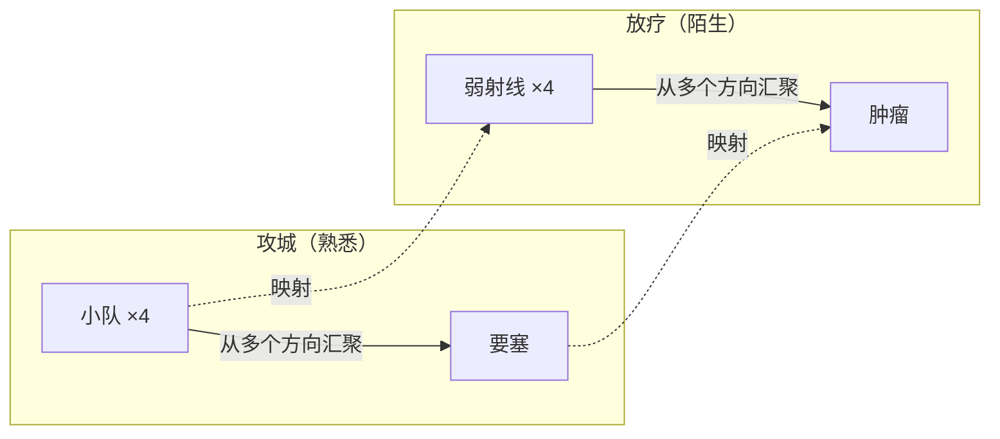
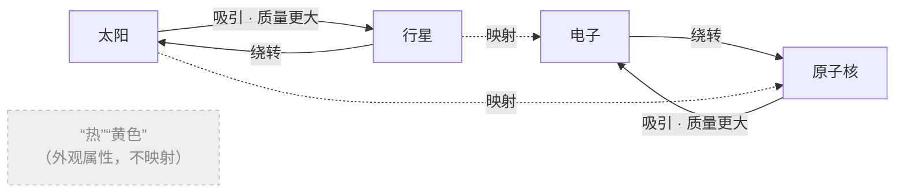
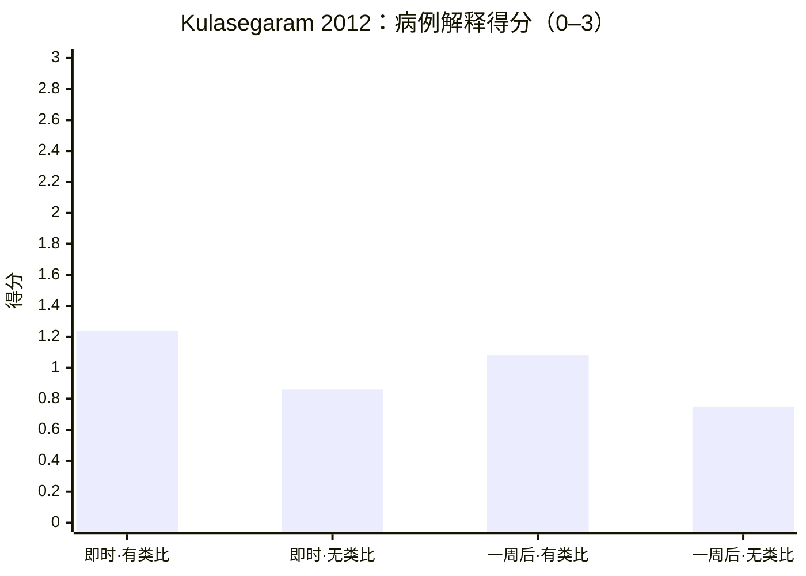
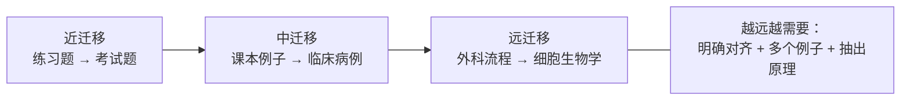
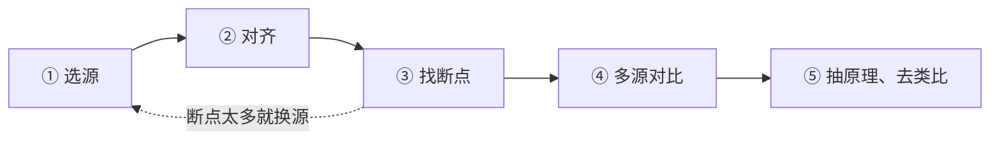

# 借熟悉学陌生：类比迁移学习法 · 60 分钟演讲课程

对应方法 [B9 类比迁移](../文档/B级方法v1.0.md#b9)。对象：临床医生、医学生、科研人员。所有图为自绘示意，引用以 [n] 标注并链接到参考文献页；不收录论文原文或原图。图文网页版由 Hark Page 生成，作者私有。

**一句话结论：** 用最熟悉的领域作桥学新领域有科学依据，但要做到四件事——按“关系”对齐而不是按外观、主动找类比失效处、用多个类比或案例对比、最后抽出原理并脱离类比。

| 项目 | 内容 |
| --- | --- |
| 证据等级 | B：理论成熟；比较/类比教学有元分析（d = 0.50）；“用个人熟悉领域类比”作为整套学法缺少直接对照 |
| 学习目标 | ① 解释类比为什么有效（结构映射）② 识别三种风险 ③ 会用桥接五步法 |
| 材料 | [类比映射表模板](../模板/类比映射表v1.0.md) |

## 课程安排

```mermaid
gantt
    dateFormat mm
    axisFormat %M 分
    section 课程
    开场问题            :a0, 00, 5m
    模块1 为什么有效    :a1, after a0, 10m
    模块2 证据          :a2, after a1, 10m
    模块3 风险与边界    :a3, after a2, 8m
    模块4 桥接五步法    :a4, after a3, 12m
    现场练习            :a5, after a4, 10m
    总结与自测          :a6, after a5, 5m
```

---

## 开场 · 0–5 分钟：一个放疗难题

胃里有一个无法手术的肿瘤；一束足以杀死肿瘤的强射线会烧伤沿途正常组织，怎么办？Gick 与 Holyoak 先让受试者读“将军攻城”故事：大军分成小队，从四面八方同时汇聚到要塞。许多读过故事的人并不会自发用它；一经提示，解题率显著上升 [[Gick & Holyoak 1980](../文档/参考文献v1.0.md#gick1980)]。

> **讲者备注：** 先让听众想 1 分钟再揭晓。强调：熟悉的知识不会自动迁移，必须主动搭桥。

## 模块 1 · 5–15 分钟：为什么熟悉能帮你

- **先行组织者：** 先给一个已熟悉的上位框架，再学陌生材料，学习和保持更好 [[Ausubel 1960](../文档/参考文献v1.0.md#ausubel1960)]。
- **结构映射：** 类比映射的是关系结构，而不是物体外观；成体系的关系（尤其因果）更容易被映射——“系统性原则” [[Gentner 1983](../文档/参考文献v1.0.md#gentner1983)；[Gentner & Markman 1997](../文档/参考文献v1.0.md#gentner1997)]。
- **共同成分：** 迁移取决于任务间共享的成分 [[Thorndike & Woodworth 1901](../文档/参考文献v1.0.md#thorndike1901)]。
- **真实实验室：** 分子生物学家组会中常用类比——解题多用近类比，解释多用远类比 [[Dunbar 1995](../文档/参考文献v1.0.md#dunbar1995)]。

> **讲者备注：** 请每位听众说出自己最熟领域里的一条因果链。

## 模块 2 · 15–25 分钟：证据

| 研究 | 对象 / 做法 | 结果 |
| --- | --- | --- |
| [Gick & Holyoak 1983](../文档/参考文献v1.0.md#gick1983) | 读并比较两个同构类比故事 | 比只读一个更能抽出图式，迁移更好 |
| [Gentner 等 2003](../文档/参考文献v1.0.md#gentner2003) | 谈判新手，3 个实验 | 两案例并排比较明显优于分别学习；比较支持越多，模拟谈判迁移率越高 |
| [Kurtz 等 2001](../文档/参考文献v1.0.md#kurtz2001) | 让学习者相互对齐两个例子 | 关系理解提升（类比自举） |
| [Alfieri 等 2013](../文档/参考文献v1.0.md#alfieri2013) | 元分析：57 个实验、336 项检验 | d = 0.50（95% CI 0.44–0.56）；找相同点、比较后再给原理、可感知内容、即时测试时更好 |
| [Richland 等 2007](../文档/参考文献v1.0.md#richland2007) | 多地数学课堂录像 | 中国香港、日本教师用类比时提供更多认知支持（视觉呈现、并置、手势）；综述见 [Richland & Simms 2015](../文档/参考文献v1.0.md#richland2015) |
| [Kulasegaram 等 2012](../文档/参考文献v1.0.md#kulasegaram2012) | n = 24，学 Starling 定律等 | 有类比 1.24 vs 无类比 0.86（0–3 分，p < 0.05）；一周后 1.08 vs 0.75（p = 0.06） |
| [Norman 2009](../文档/参考文献v1.0.md#norman2009) | 医学基础科学教学综述 | 通常不到 30% 能把概念用于新问题；日常类比、多个外观不同的练习、混合与间隔练习可把迁移提高 2–3 倍 |

> **讲者备注：** 强调样本小（n = 24），一周后差异未达显著——类比帮助理解，但迁移仍难。

## 模块 3 · 25–33 分钟：风险与边界

| 风险 | 证据 | 对策 |
| --- | --- | --- |
| 远迁移有条件 | 迁移沿 9 个维度变化，不能用单一效应量概括 [[Barnett & Ceci 2002](../文档/参考文献v1.0.md#barnett2002)]；象棋、音乐、工作记忆训练的远迁移在严谨设计中很小 [[Sala & Gobet 2017](../文档/参考文献v1.0.md#sala2017)] | 不指望“学好 A 自动会 B”，刻意搭桥 |
| 定势效应 | 国际象棋高手想到熟悉解法后，视线不断回到相关区域，错过更优解 [[Bilalić 等 2008](../文档/参考文献v1.0.md#bilalic2008)] | 类比只用来提出假设，用证据检验 |
| 类比诱发误解 | 单一类比在高级知识中易致误解，需多个类比互补 [[Spiro 等 1989](../文档/参考文献v1.0.md#spiro1989)]；类比是“双刃剑” [[Duit 1991](../文档/参考文献v1.0.md#duit1991)] | 写断点、找第二个类比 |

两条迁移通路：“低路”靠大量练习自动迁移，“高路”靠有意识地抽象原理——借熟悉学陌生属于高路 [[Salomon & Perkins 1989](../文档/参考文献v1.0.md#salomon1989)]；迁移也应看能否“为未来学习做准备” [[Bransford & Schwartz 1999](../文档/参考文献v1.0.md#bransford1999)]。

## 模块 4 · 33–45 分钟：桥接五步法与医学示例

| 步骤 | 做法 | 依据 |
| --- | --- | --- |
| ① 选源 | 选最熟、且清楚其因果结构的领域；按关系挑，不按外观挑 | [Gentner 1983](../文档/参考文献v1.0.md#gentner1983) |
| ② 对齐 | 映射表：对象↔对象、关系↔关系、因果链↔因果链 | [Gentner 2003](../文档/参考文献v1.0.md#gentner2003) |
| ③ 找断点 | 至少 3 处类比不成立之处；跨度大时用桥接类比逐步过渡 | [Harrison & Treagust 1993](../文档/参考文献v1.0.md#harrison1993)；[Brown & Clement 1989](../文档/参考文献v1.0.md#brown1989) |
| ④ 多源对比 | 第二个类比或两个同构案例并排，找相同点 | [Alfieri 2013](../文档/参考文献v1.0.md#alfieri2013)；[Spiro 1989](../文档/参考文献v1.0.md#spiro1989) |
| ⑤ 抽原理、去类比 | 不依赖类比写原理，在 2–3 个外观不同的问题上检验，再间隔复习 | [Norman 2009](../文档/参考文献v1.0.md#norman2009) |

### 示例 1：手术安全核查 → 细胞周期检查点

WHO 手术安全核查分三个时点 [[Haynes 2009](../文档/参考文献v1.0.md#haynes2009)]；“检查点”概念见 [[Hartwell & Weinert 1989](../文档/参考文献v1.0.md#hartwell1989)]。

| 手术安全核查 | 细胞周期 | 映射的关系 |
| --- | --- | --- |
| 麻醉诱导前（Sign In）：身份、部位、过敏 | G1/S 检查点：DNA 是否完好、条件是否合适 | 进入不可逆阶段前确认前提 |
| 切皮前（Time Out）：全队暂停确认 | G2/M 检查点：复制是否完整、无损伤 | 动刀 / 分裂前最后确认 |
| 离开前（Sign Out）：清点器械纱布 | 纺锤体组装检查点：所有染色体是否正确连接 | 结束前“一个都不能少” |
| 核查不过 → 暂停手术 | 检查点激活 → 周期阻滞 | 发现问题就停下 |

**断点：** 核查是人按清单打勾，可被跳过；检查点是分子信号网络，通过 CDK 活性与反馈持续调控。核查失败通常只是暂停；检查点失败可导致凋亡或衰老等永久结局。检查点失效（如 p53 通路异常）与肿瘤发生相关，手术核查没有对应的后果。

### 示例 2：损伤控制外科 → DNA 损伤应答

损伤控制外科见 [[Rotondo 1993](../文档/参考文献v1.0.md#rotondo1993)]。

| 损伤控制外科 | DNA 损伤应答 |
| --- | --- |
| 先止血、控制污染（简化手术） | 检查点阻滞、停止周期 |
| ICU 复苏、纠正生理紊乱 | 损伤修复 |
| 计划性再手术完成确定性修复 | 修复完成后恢复周期 |
| 无法挽救 | 损伤过重 → 凋亡或衰老 |

**断点：** 凋亡是细胞主动执行的程序，对机体可能是有利结局；衰老细胞还会通过分泌因子影响邻近细胞，外科类比没有对应。

示例中的生物学为入门概括，细节以教材和原始文献为准。

> **讲者备注：** 第③步写得越清楚，类比越安全。

## 现场练习 · 45–55 分钟

1. 写下一个要学的新概念。
2. 选一个你最熟的源领域。
3. 填 [类比映射表](../模板/类比映射表v1.0.md)。
4. 写 3 个断点。
5. 与邻座互换，找出对方映射中的一处错误。

## 总结与自测 · 55–60 分钟

- 映射关系，不映射外观。
- 主动搭桥，并写出断点。
- 多个类比 + 抽出原理，最后脱离类比。

Q1 结构映射理论认为类比应优先映射什么？
关系结构，尤其是成体系的因果关系，而非外观属性 [Gentner 1983]。

Q2 Gick & Holyoak 的实验说明了什么？
读过类比故事的人多数不会自发使用它，提示后解题率上升——迁移需要主动搭桥 [Gick & Holyoak 1980]。

Q3 Alfieri 等元分析中案例比较的总效应量是多少？哪种做法更好？
d = 0.50；要求找相同点、比较后再给出原理等 [Alfieri 2013]。

Q4 专家用熟悉领域类比时最大的风险是什么？
定势效应：熟悉的解法挡住更优解 [Bilalić 2008]；以及单一类比导致误解 [Spiro 1989]。

Q5 桥接五步法中哪一步最常被省略？
第③步找断点 [Harrison & Treagust 1993]。

**课后作业：** 用桥接五步法完成一张映射表；一周后不看笔记复述“不依赖类比的原理”，并加入间隔复习卡片。

[← 返回首页](../README.md) · [B9 方法条目](../文档/B级方法v1.0.md#b9) · [参考文献](../文档/参考文献v1.0.md)
